# ambientCG: Marble materials

**26 assets from [ambientCG](https://ambientcg.com), dedicated to the public domain under [CC0](https://docs.ambientcg.com/license/).** Use them in any game, free or paid, and change them however you like; no credit is needed.

PBR materials as 1K and 2K JPG maps (colour, normal GL and DX, roughness, AO, displacement), one folder per resolution. 508.3 MB in all.

This is a copy kept by [zuujis-cc0](https://github.com/zuujis-cc0) so game makers can take single files from GitHub. It is not made by or affiliated with ambientCG: the originals, often in more formats and higher resolutions, are on [ambientcg.com](https://ambientcg.com). If they help you, consider [supporting ambientCG](https://www.patreon.com/ambientCG).

Every file is listed in [MANIFEST.tsv](MANIFEST.tsv) with its size and SHA-256. More free assets: [the Zuujis collection](https://github.com/zuujis-cc0/free-game-assets#readme).

| | | | |
| :-: | :-: | :-: | :-: |
| <a href="Marble001">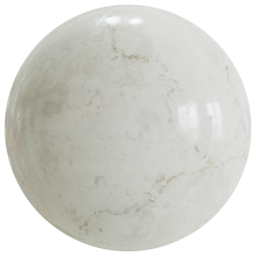</a> <b><a href="Marble001">Marble 001</a></b> by ambientCG · <a href="https://ambientcg.com/a/Marble001">source</a> | <a href="Marble002">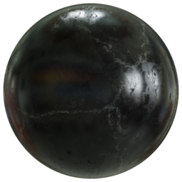</a> <b><a href="Marble002">Marble 002</a></b> by ambientCG · <a href="https://ambientcg.com/a/Marble002">source</a> | <a href="Marble003">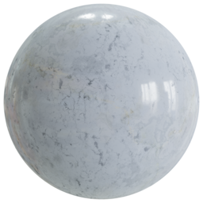</a> <b><a href="Marble003">Marble 003</a></b> by ambientCG · <a href="https://ambientcg.com/a/Marble003">source</a> | <a href="Marble004">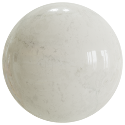</a> <b><a href="Marble004">Marble 004</a></b> by ambientCG · <a href="https://ambientcg.com/a/Marble004">source</a> |
| <a href="Marble005">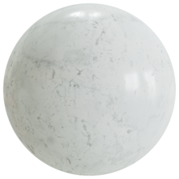</a> <b><a href="Marble005">Marble 005</a></b> by ambientCG · <a href="https://ambientcg.com/a/Marble005">source</a> | <a href="Marble006">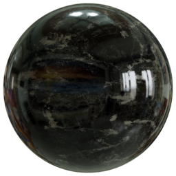</a> <b><a href="Marble006">Marble 006</a></b> by ambientCG · <a href="https://ambientcg.com/a/Marble006">source</a> | <a href="Marble007">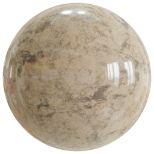</a> <b><a href="Marble007">Marble 007</a></b> by ambientCG · <a href="https://ambientcg.com/a/Marble007">source</a> | <a href="Marble008">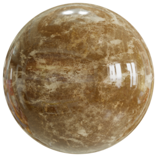</a> <b><a href="Marble008">Marble 008</a></b> by ambientCG · <a href="https://ambientcg.com/a/Marble008">source</a> |
| <a href="Marble009">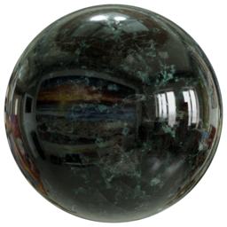</a> <b><a href="Marble009">Marble 009</a></b> by ambientCG · <a href="https://ambientcg.com/a/Marble009">source</a> | <a href="Marble010">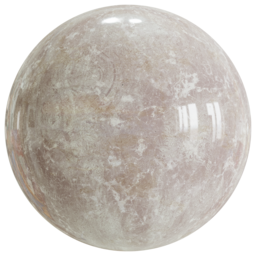</a> <b><a href="Marble010">Marble 010</a></b> by ambientCG · <a href="https://ambientcg.com/a/Marble010">source</a> | <a href="Marble011">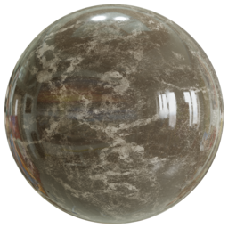</a> <b><a href="Marble011">Marble 011</a></b> by ambientCG · <a href="https://ambientcg.com/a/Marble011">source</a> | <a href="Marble012">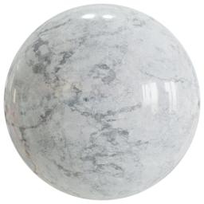</a> <b><a href="Marble012">Marble 012</a></b> by ambientCG · <a href="https://ambientcg.com/a/Marble012">source</a> |
| <a href="Marble013">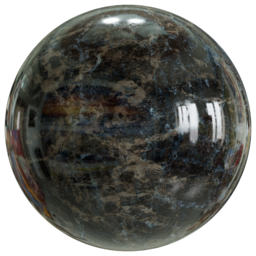</a> <b><a href="Marble013">Marble 013</a></b> by ambientCG · <a href="https://ambientcg.com/a/Marble013">source</a> | <a href="Marble014">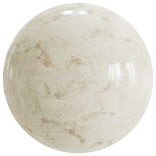</a> <b><a href="Marble014">Marble 014</a></b> by ambientCG · <a href="https://ambientcg.com/a/Marble014">source</a> | <a href="Marble015">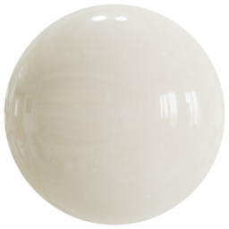</a> <b><a href="Marble015">Marble 015</a></b> by ambientCG · <a href="https://ambientcg.com/a/Marble015">source</a> | <a href="Marble016">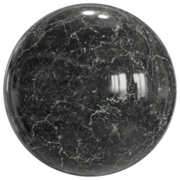</a> <b><a href="Marble016">Marble 016</a></b> by ambientCG · <a href="https://ambientcg.com/a/Marble016">source</a> |
| <a href="Marble017">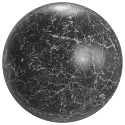</a> <b><a href="Marble017">Marble 017</a></b> by ambientCG · <a href="https://ambientcg.com/a/Marble017">source</a> | <a href="Marble018">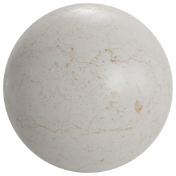</a> <b><a href="Marble018">Marble 018</a></b> by ambientCG · <a href="https://ambientcg.com/a/Marble018">source</a> | <a href="Marble019">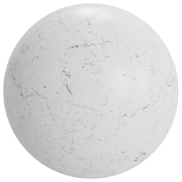</a> <b><a href="Marble019">Marble 019</a></b> by ambientCG · <a href="https://ambientcg.com/a/Marble019">source</a> | <a href="Marble020">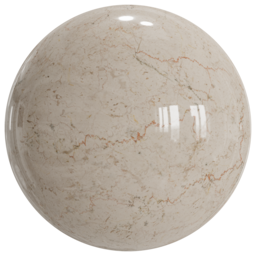</a> <b><a href="Marble020">Marble 020</a></b> by ambientCG · <a href="https://ambientcg.com/a/Marble020">source</a> |
| <a href="Marble021">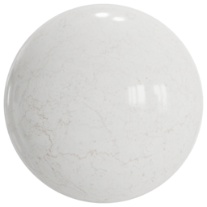</a> <b><a href="Marble021">Marble 021</a></b> by ambientCG · <a href="https://ambientcg.com/a/Marble021">source</a> | <a href="Marble022">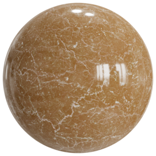</a> <b><a href="Marble022">Marble 022</a></b> by ambientCG · <a href="https://ambientcg.com/a/Marble022">source</a> | <a href="Marble023">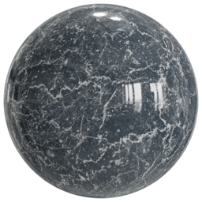</a> <b><a href="Marble023">Marble 023</a></b> by ambientCG · <a href="https://ambientcg.com/a/Marble023">source</a> | <a href="Marble024">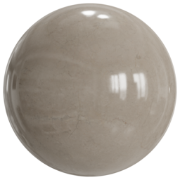</a> <b><a href="Marble024">Marble 024</a></b> by ambientCG · <a href="https://ambientcg.com/a/Marble024">source</a> |
| <a href="Marble025">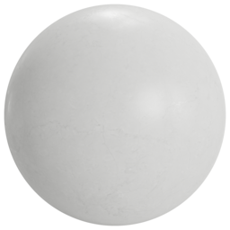</a> <b><a href="Marble025">Marble 025</a></b> by ambientCG · <a href="https://ambientcg.com/a/Marble025">source</a> | <a href="Marble026">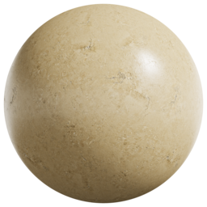</a> <b><a href="Marble026">Marble 026</a></b> by ambientCG · <a href="https://ambientcg.com/a/Marble026">source</a> |  |  |

---

Kept up to date by this repository's own [update workflow](.github/workflows/update.yml), with code and plan from [cc0-mirror](https://github.com/zuujis-cc0/cc0-mirror). Something wrong? [Open an issue there](https://github.com/zuujis-cc0/cc0-mirror/issues/new) or use the [private report form](https://games.zuujis.com/report).
